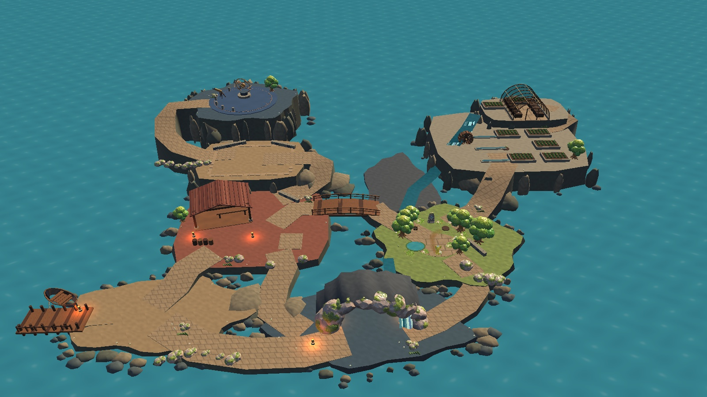

# 捡个星球慢慢造

一款以 AI 对话共创为核心，融合探索冒险、家园经营与邻里互动的 3D 沙盒游戏原型。

玩家与精灵伙伴从一片小小的落脚地出发，通过照料家园、开启宝箱、挑战土地守卫，以及拜访邻居、交换礼物，获得新的土地和物品。获得空地后，可以与常驻 AI 伙伴“小禾”讨论想法、预览并确认布置，让一颗陌生星球慢慢长成自己的小世界。



**[下载可运行试玩包](https://github.com/xiao-ge4/small-planet-slowly-build/releases/tag/v0.1.0)** · [功能与技术边界](docs/submission/BOUNDARIES.md) · [完整启动与构建说明](docs/submission/PLAYABLE-README.md)

本仓库公开代码、Unity 工程配置与场景描述；大型模型、贴图、音乐和预构建游戏完整保存在 Releases，避免让 Git 历史承载大量二进制。这里不是已部署的在线游戏地址：试玩需要在本机启动 Python 服务，然后用浏览器进入游戏。

## 评审快速试玩

1. 在 [v0.1.0 Release](https://github.com/xiao-ge4/small-planet-slowly-build/releases/tag/v0.1.0) 下载 **SmallPlanetSubmission.zip**，不要误选 GitHub 自动生成的 Source code ZIP。
2. 解压后进入 `SmallPlanetSubmission` 目录，使用 **Python 3.10+（推荐 3.12）**、macOS / Linux 和支持 WebGL 2 的桌面浏览器运行：

```sh
python3 -m venv .venv
.venv/bin/python -m pip install -r requirements-submission.txt
.venv/bin/python tools/start_submission.py
```

打开 **http://127.0.0.1:8791/** 并点击进入游戏。若 macOS 的 `python3 --version` 显示系统自带的 3.9，请先安装较新版本，并将命令中的 `python3` 换成 `python3.12`。

试玩不需要安装 Unity；不要直接双击 `index.html`。端口冲突时加 `--port 8792`。终端按 `Ctrl+C` 关闭。

试玩包约 **1.07 GB**，完整保留现有场景、精灵、动作和运行资源，因此通过 Releases 单独分发。下载后可以对照 Release 中的 `SHA256SUMS.txt` 校验完整性。

默认 `live` 模式用于真实服务。**未配置密钥时基础游玩仍可体验，真实小禾对话及付费生成不可用**；入口会显示配置状态。若只验证不调用外部服务的流程，请明确使用：

```sh
.venv/bin/python tools/start_submission.py --mode mock
```

`mock` 会明确标记为模拟模式，其确定性对话和测试生成不能作为真实 AI 能力证明。

## 推荐体验路线

- **新旅程**：从初始小院出发，照料幼苗、开启宝箱取得许可，获得空地并挑战守卫；土地逐步开放。
- **与小禾共创**：在可编辑的相邻地块，提出“只用已有资产，放一张长凳和几簇白花”等要求，查看建议、修改预览、明确确认应用，再刷新检查保存。
- **邻里互动**：拜访同星球的阿烬或另一星球的露米，照料植物、交流、完成寻物和送礼。
- **完整家园展示**：使用独立展示存档参观晨曦花园、暖焰营地及完整大地图，包含天文台。展示存档与新旅程进度分离，不代表新玩家一次解锁了整张地图。
- **夜间氛围**：体验昼夜、音乐与点灯效果。

游戏进度保存在当前浏览器的本地存储，后端档案、聊天、记忆与资产写入 `data/submission-live/`；重新打开同一浏览器和本地服务可以继续。换浏览器不会自动同步。`mock` 与 `live` 使用不同数据目录。

## 配置真实对话和生成

```sh
cp .env.example .env.local
# 用自己的凭据填写 .env.local，再启动 live 模式。
.venv/bin/python tools/start_submission.py --mode live
```

| 配置 | 用途 |
| --- | --- |
| `QWEN_AGENT_API_KEY` | 小禾真实对话、需求整理、布局建议和检查，默认 `qwen3.8-flash` |
| `TOAPIS_API_KEY`、`TOAPIS_BASE_URL` | 概念图和设计图，调用 `gpt-image-2` |
| `AHOLO_API_KEY`、`AHOLO_REGION` | Aholo 图生 3D，国内账号区域为 `cn` |
| `QWEN_API_KEY` | 旧物件工作台的可选图像服务，也是 Agent 未设独立密钥时的回退值 |

**只体验真实小禾对话和已有资产布置，先配置 Agent 密钥即可。** 生图和新模型生成另需各自密钥、权限与额度，按界面确认；调用可能产生费用。具体接口、模型和提示词配置见 `.env.example`、`/game-settings.html` 和 `/home-creation-settings.html`。

仓库和试玩包均不含有效密钥、作者存档、聊天或数据库。密钥只放在本机 `.env.local` 或服务端环境变量，不放入前端、Unity 或 Git。当前服务绑定 `127.0.0.1`，设置页未实现面向公网的管理员鉴权。

## 从 GitHub 源码运行

源码仓库不追踪大型 WebGL 构建及 Unity 二进制美术素材。克隆后，先下载本次 Release，按哈希补齐源素材和已验收构建；不必重新安装 Unity：

```sh
git clone https://github.com/xiao-ge4/small-planet-slowly-build.git
cd small-planet-slowly-build
python3 -m venv .venv
.venv/bin/python -m pip install -r requirements-submission.txt
.venv/bin/python tools/fetch_release_build.py
.venv/bin/python tools/start_submission.py
```

如果已经下载过完整试玩包，可避免再次下载：

```sh
.venv/bin/python tools/fetch_release_build.py --archive /绝对路径/SmallPlanetSubmission.zip
```

下载工具先核对完整包 SHA-256，再安装缺失的模型、贴图、音乐、字体和 WebGL。每个文件都有原版哈希校验，既有代码、密钥或存档不会被覆盖；既有源素材与 Release 不一致或已有 WebGL 目录时会拒绝覆盖。完整包里原有的启动 README 另见 [PLAYABLE-README.md](docs/submission/PLAYABLE-README.md)。

## 验证与重新构建

从 Git 克隆后，请先完成上一节的资源补齐，再运行检查或用 Unity 打开工程。完整试玩包已自带这些资源。

```sh
# 未安装 WebGL 构建时：
.venv/bin/python tools/check_submission.py --source-only
# 已下载 WebGL 或已重新构建时：
.venv/bin/python tools/check_submission.py
```

检查会在临时目录初始化干净数据库，验证 19 项资产及工程依赖、基础 API 和 WebGL HTTP 资源；不会调用付费接口。实际渲染和真实模型返回仍需浏览器与自己的密钥验证。解压试玩包额外包含逐文件哈希清单；Git 仓库本身不携带作者工作区的旧清单。

Unity 工程位于 `unity/DawnGarden/`，版本 **6000.3.27f1**。重新构建需要 Unity Hub、对应编辑器和 WebGL Build Support；浏览现成试玩包不需要这些工具。将 `UNITY_EDITOR` 设为本机编辑器路径后，可运行：

```sh
"$UNITY_EDITOR" -batchmode -nographics -projectPath "$PWD/unity/DawnGarden" \
  -executeMethod DawnGarden.Editor.SmallWorldWebGLBuilder.BuildWebGL \
  -logFile /tmp/small-planet-webgl.log -quit
```

资产目录需要的精确版本 Unity 包保留在 `Packages/` 中，其他包按锁文件由 Unity 解析。新生成 GLB 的归一化和 LOD 制作还需要本机 Blender；完整作者侧装配需要 Unity 编辑器。这些本地工具不会在网页内执行。

## 当前能力与边界

- 小禾接入真实对话、受约束的家园操作、显式偏好和共同经历；模型不能直接改写奖励或游戏事实。
- 实时布置针对玩家首个相邻地块，支持已有目录资产的平面位置、Y 轴旋转、受限缩放和改色，并校验边界与入口，需预览确认才应用。
- 完整大地图是预先制作的展示内容；故事演示中的预设对白、施工时序和镜头不等于当场实时生成了整张地图。
- 当前邻居是持久化 NPC，没有真人在线多人联机；不支持任意代码生成、任意新玩法生成或任意地形重塑。
- Windows 本地服务尚未适配 `fcntl`；作者工具包装默认使用 macOS 安装路径，换平台需调整。

详细说明及第三方资源来源见 [BOUNDARIES.md](docs/submission/BOUNDARIES.md)。保留原有 Unity 包、字体、模型查看器等许可证与素材 provenance，不额外变更第三方授权。

## 主要源码

| 路径 | 内容 |
| --- | --- |
| `backend/game/` | 小禾、游戏状态、运行时家园操作 |
| `backend/home_creation/` | 概念图、模型生成、资产目录与可恢复创作流程 |
| `home_server.py` | 网页、WebGL 与 API 的同源本地服务 |
| `unity/DawnGarden/` | 游戏 C#、动作与场景描述；大型源素材由 Release 按原样补齐 |
| `web/submission/` | 提交版入口与 WebGL 加载页面 |
| `docs/submission/seed/` | 19 项干净种子资产，不含作者私人数据 |
| `tools/` | 启动、初始化、下载、验证和打包工具 |
